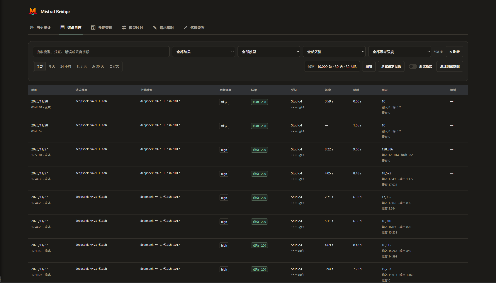
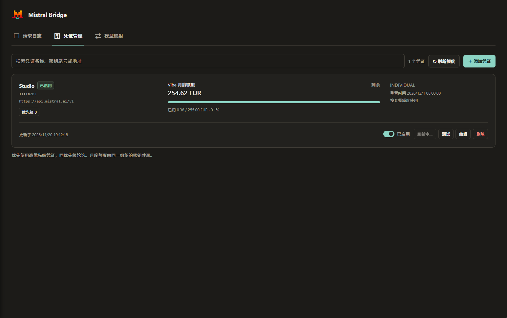
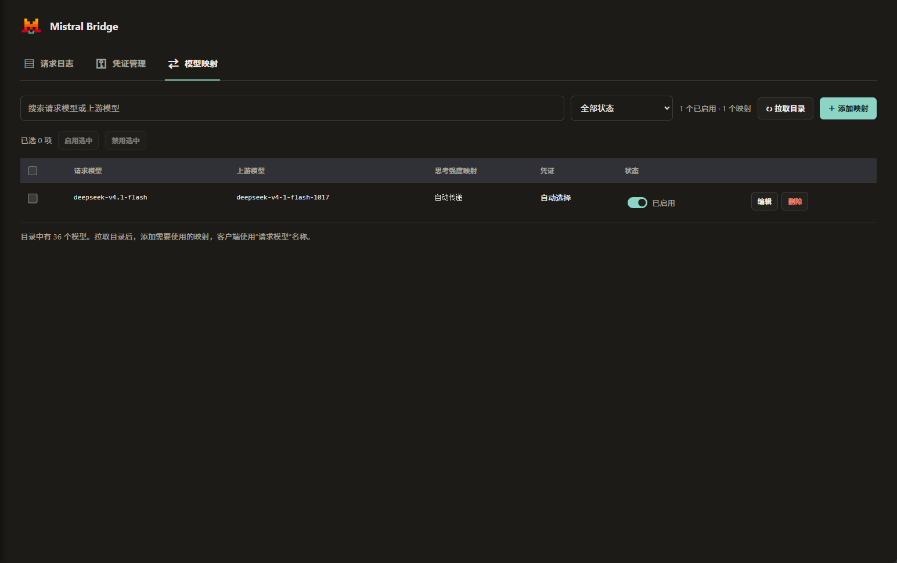

<div align="center">


# Mistral Bridge

Connect Mistral to CPA for OpenAI-compatible clients.

[](https://github.com/RzMY/MistralBridge/actions/workflows/build.yml)
[](go.mod)
[](https://github.com/RzMY/MistralBridge/releases)

[简体中文](README.md) · **English**

[Releases](https://github.com/RzMY/MistralBridge/releases) · [Build artifacts](https://github.com/RzMY/MistralBridge/actions/workflows/build.yml) · [Report an issue](https://github.com/RzMY/MistralBridge/issues)

</div>

Mistral Bridge is a native dynamic-library plugin for CLIProxyAPI (CPA). It adapts Mistral requests, responses, and reasoning fields to OpenAI Chat Completions and provides a web console for credentials, model mappings, and request logs. See the [technical design document (Chinese)](docs/technical-design.md) for implementation and maintenance details.

## Features

- **Protocol adaptation** converts assistant reasoning fields, Mistral thinking/text content, and streaming deltas, including reasoning in tool-call messages.
- **Credential management** adds, edits, and tests multiple keys, switches Vibe / Studio request channels, displays both monthly budgets, and configures enabled state and scheduling priority.
- **Model mappings** fetch the upstream catalog and configure client-facing names and reasoning-effort mappings. Changes to mappings and their enabled state update CPA's model list.
- **Request logs** filter by model, result, credential, reasoning effort, and time range, with request counts, tokens, cache hit rate, and generation speed.
- **Request debugging** stores complete upstream requests and responses when enabled, including streaming data and error bodies. Credentials are redacted. The latest 100 exchanges are retained separately and can be viewed or cleared from the request log.
- **Request editing** maps common OpenAI, Responses, Claude, and Gemini parameters through an independent switch enabled by default. Custom rules set, copy, move, or delete body and header fields. A separate automatic cleanup switch, also on by default, removes remaining unsupported fields after these rules and shows discarded paths and value summaries in request logs. Includes ordering, individual toggles, JSON Pointer array wildcards, and a preview that makes no upstream call. See the [configuration guide (Chinese)](docs/request-edit.md).
- **Independent proxy** supports HTTP, HTTPS, SOCKS5, and SOCKS5H URLs, including username and password, in the **代理设置** (Proxy settings) tab. Chat, streaming, credential tests, catalog fetches, and quota queries use this proxy when configured. Leaving it empty preserves CPA's HTTP transport and proxy settings.
- **Panel integration** reuses saved same-origin CPA / CPAMP management sessions and follows CPAMP's light and dark themes.

## Interface Preview





## Installation and setup

CPA must support C ABI v1 and plugin schema version 10. The plugin has been verified with CPA `v8.0.78` and CPAMP.

### Online Installation

Install Mistral Bridge from the CLIProxyAPI repository (official repository) in the CPA plugin marketplace.

### Manual Installation

1. Download the appropriate ZIP from Releases or the artifacts of a successful Actions run. Select the operating system and architecture of **the host or container running CPA**.
2. Extract the library into the matching operating-system and architecture directory under CPA's plugin directory. For Linux amd64, use `plugins/linux/amd64/mistral-bridge.so`.
3. Enable the plugin in CPA's configuration and restart CPA.

```yaml
plugins:
  enabled: true
  dir: plugins
  configs:
    mistral-bridge:
      enabled: true
```

| CPA platform | Supported architectures | Library inside ZIP |
| --- | --- | --- |
| Linux | amd64, arm64 | `mistral-bridge.so` |
| macOS | amd64, arm64 | `mistral-bridge.dylib` |
| Windows | amd64, arm64 | `mistral-bridge.dll` |

Linux release packages use Ubuntu 22.04 as their build baseline and support glibc 2.35 or newer, including the Debian Bookworm CPA image. For Docker, mount the plugin directory into the container at the location configured by `plugins.dir`.

### First use

1. Open **Mistral Bridge** from the CPA / CPAMP sidebar. The standalone console path is `/v0/resource/plugins/mistral-bridge/console`.
2. Go to **凭证管理 → 添加凭证** (Credentials → Add credential) and enter a Mistral key. The default API URL is `https://api.mistral.ai/v1`.
3. Open **模型映射** (Model mappings), click **拉取目录** (Fetch catalog), then **添加映射** (Add mapping). Select an upstream model, enter the request model name, and set its state to **已启用** (Enabled).
4. Wait for confirmation that CPA's model list has synchronized. Configure your client with CPA's API URL and client API key, then select the request model you configured.

A fresh installation starts with empty credentials, catalog, mappings, and logs. Fetching the catalog updates upstream choices. Enabled mappings determine which models clients can use. When opening the console directly, connect with the management key for that panel.

## Calling a model

For example, configure the following mapping.

| Request model | Upstream model |
| --- | --- |
| `mistral-small` | `mistral-small-latest` |

Send a request to CPA's `/v1/chat/completions` with `model` set to `mistral-small`.

```json
{
  "model": "mistral-small",
  "messages": [{"role": "user", "content": "Hello"}],
  "stream": true
}
```

Request model names are used directly in CPA's model list and API calls. With automatic credential selection, the highest-priority enabled keys are selected in round-robin order. An explicit credential binding uses that credential.

A reasoning-effort mapping can use `high=medium, low=none`. Leaving it empty forwards the requested effort. Supported values depend on the upstream model.

Open **请求编辑** (Request editing) to configure input transformations. For example, `seed` maps to `random_seed` and `max_completion_tokens` maps to `max_tokens`, preserving an existing non-null native value. Custom rules run after builtin mappings, before model and reasoning mappings, credentials, and request channels. Both completion paths use the same rules; saved changes apply without restarting. Incoming headers are rule sources and are only forwarded when explicitly set or copied by a rule.

## Quotas, logs, and data

| Item | Behavior |
| --- | --- |
| Debug details | Off by default. When enabled, full upstream requests and responses are stored and may contain prompts and model output. Authentication headers and the configured key are redacted. Up to 100 records and 256 MiB are retained. A record exceeding the storage limit is skipped. Disabling debug mode does not clear existing records. |
| Request channel | Choose Vibe, Studio / API, or the key's creation source. Vibe adds `metadata.call_source="vibe_code"`; Studio removes this field while preserving other metadata. Changes apply to new requests without restarting. Creation source and request channel are displayed separately. |
| Monthly quota | Displays both Vibe and Studio / API budgets, including remaining allowance, usage percentage, reset time, pay-as-you-go status, and refresh status. The current request channel is highlighted. Keys in the same organization share the corresponding budget. |
| Unavailable quota | Displays the upstream status or error. A previous result retains its timestamp. Custom API URLs display quota lookup as unavailable. |
| Request details | Time, request model, upstream model, reasoning effort, result, masked credential, first-token time, total duration, and token usage. |

Studio uses the upstream default billing route; Mistral determines the actual charged pool. Remote checks showed that a Studio-created key can charge Vibe with the Vibe marker, while a Vibe-created key still charged Vibe after removing it. The console displays a note for that configuration and distinguishes the selected channel from a confirmed billing result.
| Statistics | Apply filters to the most recent 10,000 retained requests, with paginated details. Missing historical fields display `—`. |
| Cache hit rate | Cached tokens divided by input tokens across requests that reported cache usage. |
| Average token speed | Output tokens from successful streaming requests divided by their combined generation time after the first token. Non-streaming requests display `—` for first-token time. |

State is stored at `<auth-dir>/plugin-data/mistral-bridge/state.json`, with request metadata in `requests.jsonl` and debug details in `debug-logs/`. When CPA's `auth-dir` is unavailable, the fallback is `$HOME/.cli-proxy-api/plugin-data/mistral-bridge`. Set `MISTRAL_BRIDGE_DATA_DIR` to use a different directory.

`state.json` contains upstream keys. The console displays masked values. Persist the plugin and data directories when using containers. To repeat first-time setup, stop CPA, back up and move this plugin's data directory, then start CPA again.

The proxy URL is stored in the same `state.json` as `proxy_url` and applies to new requests after saving. Click **沿用 CPA 配置** (Use CPA configuration), or clear the URL and save, to restore CPA's HTTP callbacks. Independent proxy mode retains the plugin's request logs and debug details, while upstream requests bypass CPA's `host.http` callbacks.

## Build from source

Use Go 1.26.11 and a C compiler for the target platform. On Linux amd64, run the following command.

```sh
CGO_ENABLED=1 GOAMD64=v1 CGO_CFLAGS="-O2 -g -march=x86-64" \
  go build -trimpath -buildvcs=false -buildmode=c-shared \
  -ldflags="-s -w -X main.pluginVersion=0.2.1" \
  -o build/mistral-bridge.so .
```

Other platforms build on native runners. CPU baselines are amd64 v1 and ARMv8.0. The workflow contains the test and packaging commands. [Build workflow](.github/workflows/build.yml)

Windows ARM64 uses the `windows-11-arm` runner with Clang and native Python from MSYS2 CLANGARM64, then loads the DLL to verify the C ABI. Go does not support race detection on Windows ARM64, so that platform runs regular Go tests while the other platforms retain race detection.

```sh
go test -race -count=1 ./...
go vet ./...
node --check web/app.js
python3 -m unittest discover -s scripts -p 'test_*.py' -v
```

## Automated builds and releases

A push to `main` runs checks, tests, builds for six platforms, and dynamic-library loading checks. The resulting `mistral-bridge-dev-<commit>` Actions artifact is retained for 14 days.

Pushing a numeric version tag such as `v0.2.1` runs the same pipeline and creates a **Release draft** with generated notes after all checks pass. The tag sets the embedded plugin version. The draft includes six platform ZIPs and SHA-256 `checksums.txt`. Asset names follow `mistral-bridge_<version>_<goos>_<goarch>.zip`, with the corresponding dynamic library at the ZIP root.

```sh
git tag v0.2.1
git push origin v0.2.1
```

Replace the example version with the version you intend to release. Reruns update existing drafts and attachments, while published releases are protected. Review and publish the draft when ready. The store discovers versions through GitHub's latest-release API. The workflow uses the repository's automatic `GITHUB_TOKEN`. [Plugin store requirements](https://github.com/router-for-me/CLIProxyAPI-Plugins-Store#release-requirements)

## Acknowledgements

Thanks to CPA for the plugin runtime, magpie for the Mistral protocol reference, and ClinePassBridge for management UI and documentation organization references. [CLIProxyAPI](https://github.com/router-for-me/CLIProxyAPI) · [magpie](https://github.com/yetone/magpie) · [ClinePassBridge](https://github.com/xiao-qiu-qiu/ClinePassBridge)

The project icon adds a bridge element to Mistral's pixel mark to identify this community plugin. The Mistral name and original mark belong to Mistral. [Brand assets](https://mistral.ai/brand/)
