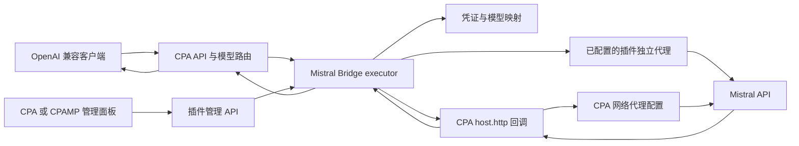

# Mistral Bridge 技术设计

本文面向维护插件、排查协议问题和构建发布包的开发者。功能行为以当前源码为准。

## 设计边界

Mistral Bridge 是 CLIProxyAPI（CPA）的原生 Go 动态库插件。CPA 负责接收客户端 HTTP 请求、管理 API 鉴权、执行模型路由，以及提供带 CPA 网络代理配置的 HTTP 回调。插件负责凭证和映射状态、Mistral 请求转换、响应规范化、用量统计和管理页面。

插件通过 CPA 提供的 C ABI v1 和 JSON RPC 方法与宿主通信。未配置独立代理时，网络请求使用 `host.http.do` 或 `host.http.do_stream`，沿用 CPA 的 HTTP 出口策略。配置独立代理后，由 [proxy.go](../proxy.go) 使用 Go HTTP Transport 发送请求，显式覆盖环境代理，支持 HTTP、HTTPS、SOCKS5 和 SOCKS5H。该路径保留插件日志和调试捕获，但不经过 CPA 的 HTTP 回调日志。主要入口位于 [main.go](../main.go)、[plugin.go](../plugin.go) 和 [mistral.go](../mistral.go)。

控制台 HTML、CSS、JavaScript 和图标通过 Go `embed` 编译进动态库。面板内打开时复用同源 CPA / CPAMP 管理会话；直接打开控制台时显示管理密钥连接入口。

## 插件生命周期

`main.go` 导出 `cliproxy_plugin_init`、`cliproxyPluginCall`、`cliproxyPluginFree` 和 `cliproxyPluginShutdown`。初始化时注册 ABI 版本 1 和宿主回调函数。每个 RPC 请求通过 `handleMethod` 分派，响应包装为 `{ "ok": true, "result": ... }` 或包含 HTTP 状态的错误对象。

`plugin.register` 返回 schema version 10、插件元数据和能力声明。当前声明的主要能力如下。

| 能力 | 用途 |
| --- | --- |
| `model_provider` | 从已启用映射生成 CPA 模型列表 |
| `model_router` | 判断请求模型是否由本插件处理 |
| `executor` | 执行非流式和流式 Chat Completions |
| `thinking_applier` | 将 CPA 思考级别写入请求字段 |
| `management_api` | 注册控制台页面与管理路由 |
| `usage_plugin` | 注册用量回调，目前返回空结果 |

`executor.count_tokens` 返回 HTTP 501，因为当前上游路由不提供此插件能力。

## 模型与凭证解析

模型映射包含请求模型名、上游模型名、可选思考映射、可选凭证绑定和启用状态。只有已启用映射会由 `model.static` 发布给 CPA。客户端可使用不带插件前缀的请求模型名，也可使用 `mistral-bridge/` 前缀。路由和执行时都会移除此前缀再匹配 `client_model`。

每个已发布模型声明 128,000 的上下文长度、8,192 的最大输出 Token，并声明 `temperature`、`top_p`、`max_tokens`、`reasoning_effort`、`tools`、`tool_choice` 和 `stream` 参数。

请求处理按以下规则选择凭证。

1. 映射包含 `key_id` 时，只考虑绑定且已启用的凭证。
2. 映射未绑定凭证时，考虑全部已启用凭证。
3. 只选择最高优先级的一组，同优先级凭证通过原子计数轮询。

映射不存在、被禁用或没有可用凭证时，请求不会发给 Mistral。凭证优先级范围为 `-1000` 到 `1000`。

模型目录拉取调用凭证 API 地址下的 `/models`。如果目录条目都没有 `completion_chat` 字段，目录中的非空模型 ID 会作为候选项；只要上游提供了该字段，插件就只保留值为 `true` 的模型。目录同步只更新候选目录，不会自动创建或启用映射。

模型映射和 CPA 模型列表通过 revision 同步。插件以当前映射 JSON 的 SHA-256 前 12 字节计算 `models_revision`。控制台调用 CPA 自身的 `PATCH /v0/management/plugins/mistral-bridge/config` 写入该 revision，CPA 随后调用 `model.static` 重新读取模型。此时插件更新 `published_revision`，控制台通过两者相等判断同步完成。这个配置路径由 CPA 提供，不是插件注册的自定义管理路由。

## 请求转换

执行器只处理 OpenAI Chat Completions 格式。插件使用匹配到的映射覆盖请求体中的 `model`，保留其余未转换字段，并按需要改写思考字段。

每条消息的 OpenAI `developer` 角色会转换为 Mistral 支持的 `system` 角色，消息内容和顺序保留。转换在插件执行器中完成，同时覆盖 Chat Completions 入口与 CPA 转换后的 Responses 请求，以及流式和非流式调用；工具参数 schema、工具调用参数与 metadata 内的同名文本不受影响。Mistral 不支持 `developer` 角色，直接透传会触发 `body.messages[i]` 的 `union_tag_invalid` 和 HTTP 422。

消息 `content` 数组中各内容块的 `cache_control` 会在发送前移除。该客户端缓存提示字段不属于 Mistral 内容块 schema，透传会触发 HTTP 422。文本、多模态内容和工具参数 schema 保留。

OpenAI 请求顶层的 `store` 会移除，包括 DSH chat 协议默认发送的 `store: false`；Mistral 不支持该字段，关闭存储也会触发 HTTP 422。`max_completion_tokens` 转换为 Mistral 的 `max_tokens`，已有非空 `max_tokens` 时优先保留原值，空的 `max_completion_tokens` 不发送。工具参数 schema 与 metadata 内同名字段不受影响。

### 思考字段

请求顶层的 `reasoning_effort` 经过映射后发送给上游。映射项以逗号分隔，例如 `high=medium, low=none`。没有配置映射时，请求值会被规范化为小写。`off` 会转换为 `none`。配置了映射但没有匹配项时，仍传递规范化后的原值。

消息中的 `reasoning_content`、`reasoning` 和 `reasoning_details` 会被抽取并移除。只有 `assistant` 消息会把思考文本编码为 Mistral 的 `thinking` 内容块，并放在文本内容之前。已有数组内容会保留并接在思考块后面，工具调用等其他消息字段保留。

### 流式与非流式请求

非流式请求通过统一 HTTP 分派发送到凭证 API 地址下的 `/chat/completions`。配置独立代理时使用插件 HTTP Transport，否则调用 `host.http.do`。插件读取原始响应体并规范化后返回 CPA。

流式请求根据配置通过插件 HTTP Transport 或 `host.http.do_stream` 打开上游流。插件确保请求中的 `stream` 为 `true`，并在 `stream_options` 中设置 `include_usage: true`。上游数据由本地响应体或 `host.http.stream_read` 分块读取，插件逐行规范化 SSE 事件，再通过 `host.stream.emit` 传给 CPA。客户端断开时，普通模式结束读取；调试模式会继续读取上游以保存完整响应。流关闭时释放响应体和请求上下文。

### 响应规范化

非流式响应的 `choices[].message.content` 和流式响应的 `choices[].delta.content` 如果是 Mistral 内容块数组，插件会拼接其中的 `text` 块作为 OpenAI `content`，并把 `thinking` 块文本写入 `reasoning_content`。数组中其他类型的内容块当前不会转换。响应根对象、usage、finish reason 和工具调用等其他字段会保留。流式模式对每个 `data:` 事件执行相同转换，其他 SSE 行原样转发。

非流式响应和 SSE usage 都会提取输入、输出和总 Token。缓存 Token 从 `prompt_tokens_details.cached_tokens` 或兼容字段 `num_cached_tokens` 读取。`total_tokens` 缺失时由输入与输出 Token 相加得到。

上游错误支持字符串消息以及 `detail`、`error.detail`、`message.detail` 和 `error.message.detail` 包装的校验数组。校验摘要只保留字段路径 `loc` 和原因 `msg`，不向客户端转发包含原始请求数据的 `input`。

## 凭证与额度

凭证记录包含名称、API Key、上游 API 地址、启用状态、优先级、创建时间、创建来源 `source`、使用渠道 `channel` 和双池额度 `quotas`。API Key 保存在本地 `state.json`。管理 API 返回的 `safeKey` 不包含原始 Key，只返回尾号掩码和供控制台管理使用的公开字段。

渠道可选 `auto`、`vibe`、`studio`；旧记录未配置渠道时按创建来源选择，`chat` 对应 Vibe，`api` 对应 Studio。创建来源未知时自动模式保持原请求，页面提示可手动选择。普通和流式聊天请求在协议转换后统一处理渠道：Vibe 覆盖 `metadata.call_source` 为 `vibe_code`，Studio 移除该键；其他 metadata 保留，空 metadata 对象移除。改变标记的值不能用于强制 Studio 计费。Studio 路径使用上游默认计费，实测 Vibe 来源 Key 仍可能扣 Vibe 池，因此页面标识当前请求渠道，并为此配置显示扣费提示。

连接测试通过所选凭证请求模型目录。额度查询只对 Mistral 官方 HTTPS 主机启用，并按插件代理配置选择独立 HTTP 通道或 CPA HTTP 回调，请求 Vibe 身份、预算和订阅接口。`whoami.plan_type` 保存创建来源，身份查询失败不阻断双池预算查询。`quotas.vibe` 与 `quotas.studio` 分别读取 `vibe_budget`、`api_budget`，按量付费设置也按池解析。额度刷新按凭证 ID 合并并发请求，5 分钟内默认复用已有结果。单池失败保留该池上次成功结果与时间，并附带最新错误；并发切换渠道不会被额度刷新覆盖。保留旧 `quota` 字段作为当前请求渠道的预算视图，旧单池缓存不会误用于另一个池。

`PATCH /proxy` 接收 `proxy_url` 字符串；空字符串恢复沿用 CPA 配置。配置经过协议、主机和端口校验，并通过现有原子状态写入持久化；保存失败时回滚。代理支持 URL 中的认证信息，设置页直接显示地址。聊天请求开始时读取代理配置快照，保存变更不切换正在进行的流。代理 Transport 复用连接，切换配置或插件关闭时清理空闲连接。

## 管理 API

管理路由由 `management.register` 注册，路径前缀为 `/v0/management/plugins/mistral-bridge`。鉴权由 CPA 管理 API 负责，插件没有单独的管理密钥。控制台资源路径为 `/v0/resource/plugins/mistral-bridge/console`。

| 方法和路径 | 行为 |
| --- | --- |
| `GET /state` | 返回凭证掩码、模型目录、映射和 revision |
| `POST /keys`、`PATCH /keys` | 添加或编辑凭证 |
| `POST /keys/test`、`POST /keys/quota` | 测试凭证或刷新额度 |
| `PATCH /keys/channel` | 持久化渠道切换，保留凭证其他设置、创建来源与双池额度 |
| `PATCH /keys/toggle`、`DELETE /keys/delete` | 启用、停用或删除凭证 |
| `POST /models/sync` | 从上游拉取候选模型目录 |
| `POST /models`、`PATCH /models` | 添加或编辑映射，或批量切换启用状态 |
| `DELETE /models/delete` | 删除映射 |
| `GET /logs` | 查询筛选后的请求日志和统计 |
| `GET /logs/debug?id=...` | 读取一条调试记录 |
| `PATCH /debug`、`DELETE /debug` | 启用或关闭调试模式，或清理调试明细 |
| `DELETE /logs` | 清空普通请求日志和调试明细 |

## 数据与日志

默认数据目录由 CPA 提供的 `auth-dir` 决定。插件数据位于 `<auth-dir>/plugin-data/mistral-bridge/`。如果宿主未提供该目录，插件使用 `$HOME/.cli-proxy-api/plugin-data/mistral-bridge/`。设置 `MISTRAL_BRIDGE_DATA_DIR` 后会优先使用该目录。

| 文件或目录 | 内容和限制 |
| --- | --- |
| `state.json` | 凭证、模型目录、模型映射和调试模式设置 |
| `requests.jsonl` | 请求元数据，内存和磁盘最多保留 10,000 条，文件超过 16 MiB 时压缩到保留集 |
| `debug-logs/<id>.json` | 单条调试交换记录，最多保留 100 条，总量最多 256 MiB |

状态变更通过临时文件和原子替换写入。写入期间使用互斥锁，写入失败会恢复内存中的旧状态。插件创建数据目录时请求 `0700` 权限，并将状态、请求日志和调试文件设置为 `0600`。`state.json` 中的 API Key 是明文，因此 CPA 数据卷需要作为凭证存储保护。

普通请求日志记录时间、请求和上游模型、思考强度、凭证标签及掩码、状态码、首字时间、总耗时和用量。统计基于筛选后的日志。缓存命中率按报告缓存用量的请求计算缓存 Token 总和除以输入 Token 总和。平均 Token 速率按成功流式请求的输出 Token 总和除以首字后生成耗时总和。

## 调试模式

调试模式默认关闭。每个请求在开始时读取一次开关状态，因此切换开关只影响之后开始的请求。启用后，插件保存实际发往 Mistral 的方法、URL、请求头和转换后请求体，以及上游响应状态、响应头和原始响应体。调试记录展示转换后的上游请求，不包含 CPA 收到的客户端原始请求报文。流式请求按读取顺序拼接响应块，非流式请求保存完整响应体。调试记录通过 `DebugAvailable` 标记回链到普通请求日志。

保存前会遮蔽 Authorization、API Key、Token、Cookie 和 Secret 类请求头，并将当前凭证的完整 Key 从 URL、请求体、响应体和错误文本中替换为 `[redacted]`。其他提示词、模型输出和业务字段会保留，因此调试文件可能包含敏感数据。调试记录没有额外加密，访问控制依赖 CPA 管理 API 和宿主文件权限。

调试数据按最近修改时间清理，最多保留 100 条且总量不超过 256 MiB。超过 256 MiB 的单条记录不会保存。关闭调试开关不会删除已保存记录。控制台可单独清理调试数据，清空请求日志也会删除调试明细。

流式上游返回非 2xx 状态时，调试模式会读取错误流并保存响应正文。关闭调试模式时，为避免额外读取开销，错误流会直接关闭。普通日志仍记录上游状态和解析得到的错误摘要。

上游错误支持字符串消息及 `detail` 验证错误数组。数组错误摘要包含字段位置和错误说明，不包含 `input` 中的提示词，完整错误正文仍保存在调试明细中。

## 构建与发布

构建需要 Go 1.26.11 和目标平台 C 编译器。插件使用 `-buildmode=c-shared` 生成 CPA 可加载的动态库。Linux 构建基线为 Ubuntu 22.04 和 glibc 2.35，amd64 使用 `GOAMD64=v1`，arm64 使用 `GOARM64=v8.0`。

核心校验包括 Go 格式检查、前端 JavaScript 语法检查、发布工具单元测试、Go 测试、`go vet`、动态库 C ABI 加载及插件注册版本验证。Windows ARM64 不运行 race 检测。测试和构建细节维护在 [build.yml](../.github/workflows/build.yml) 和 [scripts](../scripts)。

发布工作流固定使用 Go 1.26.11。推送到 `main` 会为 Linux、macOS 和 Windows 的 amd64、arm64 构建六个平台包。单平台包保留 7 天，合并后的完整产物保留 14 天。推送 `vX.Y.Z` 数字版本 tag 会创建 Release 草稿。每个 ZIP 只包含对应动态库，平台资产名为 `mistral-bridge_<version>_<goos>_<goarch>.zip`，发布集合同时提供 `checksums.txt`。

手动安装时，将动态库放入 CPA 插件目录对应的平台和架构目录，例如 Linux amd64 使用 `plugins/linux/amd64/mistral-bridge.so`。在 CPA 配置中启用 `mistral-bridge` 后重启 CPA。Docker 部署需要持久化插件目录和 `<auth-dir>` 数据目录。更多面向使用者的安装步骤见 [README](../README.md)。
